# VPS: UML architecture

Vocal Practice Studio, drawn from the code at `v0.0.92` (mps-core `v0.14.0`). Thirteen [Mermaid](https://mermaid.js.org/) diagrams; they render on GitHub and in VS Code's Markdown preview. Mermaid has no native UML component or deployment diagram, so those are flowcharts with the UML meaning in the caption.

What is shared with SPS is shown as **mps-core** and not redrawn here: see [Shared core](shared-core.md) and the mps-core diagrams in `core/wiki/uml.md`. The workspace-level picture of both apps is `MPS/wiki/uml-architecture.md`. When code and a diagram disagree, the code wins; fix the diagram.

| # | Diagram | Kind | Question |
|---|---|---|---|
| 1 | Layers and processes | Deployment | What runs, and where does each concern live? |
| 2 | Screens and panels | Component | Which page shows which components, and what makes a panel movable? |
| 3 | Domain model | Class | What is a Song, a Take, a Folder, and what is stored per take? |
| 4 | Data on disk | Component | Which files hold which part of the model? |
| 5 | Player store | Class | How is the player state split into slices? |
| 6 | AudioEngine | Class | What does the fixed vocals / instrumental / takes engine own? |
| 7 | Live analysis chain | Component | How does the microphone become pitch, spectrum and coaching? |
| 8 | Rust backend | Class | Which modules make up the Tauri shell, and who calls the sidecar? |
| 9 | Python sidecar | Component | Which commands exist and which module serves each? |
| 10 | Process a song | Sequence | From the import click to a song in the library. |
| 11 | Record a take | Sequence | Count-in, recording, analysis, and the take in the list. |
| 12 | Recording states | State | The flags in the recording slice as a state machine. |
| 13 | Send to phone | Sequence | The LAN hand-off of a practice pack to VPP. |

---

## 1. Layers and processes (deployment view)

VPS is the app with the **analysis** concern: pitch, vibrato, dynamics, timing, spectrum and spectrogram. Heavy analysis runs in the Python sidecar; live feedback runs in the WebView.

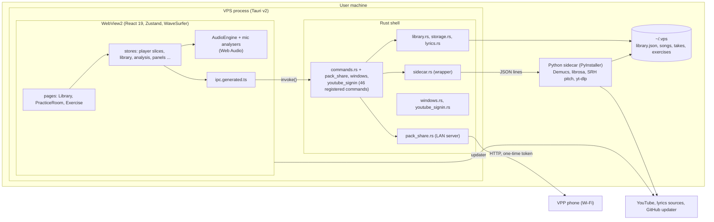

## 2. Screens and panels (component view)

`App.tsx` holds a three-way route in state (no router). The practice room is a stack of **panels**; each panel id is in a panel store (visibility and order, persisted), and the ones in `DetachablePanel` can also leave the window.

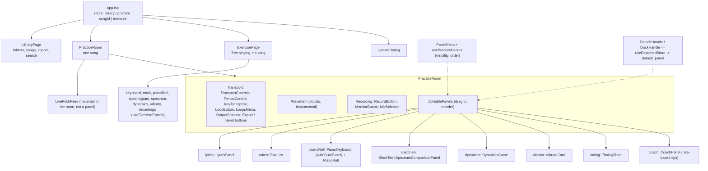

## 3. Domain model (class view)

TypeScript types are in `src/lib/types.ts`; the Rust twins are in `library.rs` and `commands.rs` (camelCase over the wire). Analysis results of a take are stored as JSON blobs inside the take.

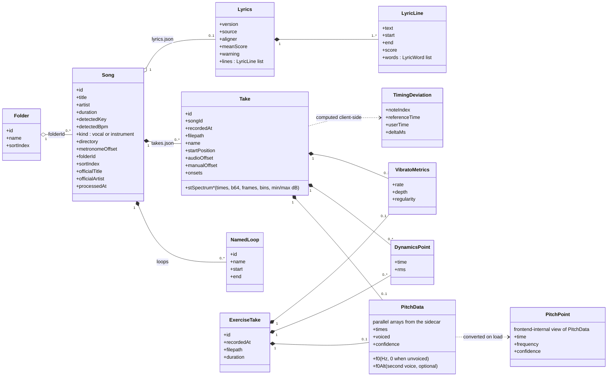

## 4. Data on disk (component view)

`~/.vps` (see `storage.rs`). The Rust shell is the only writer of the JSON files; the sidecar writes audio and analysis next to them.

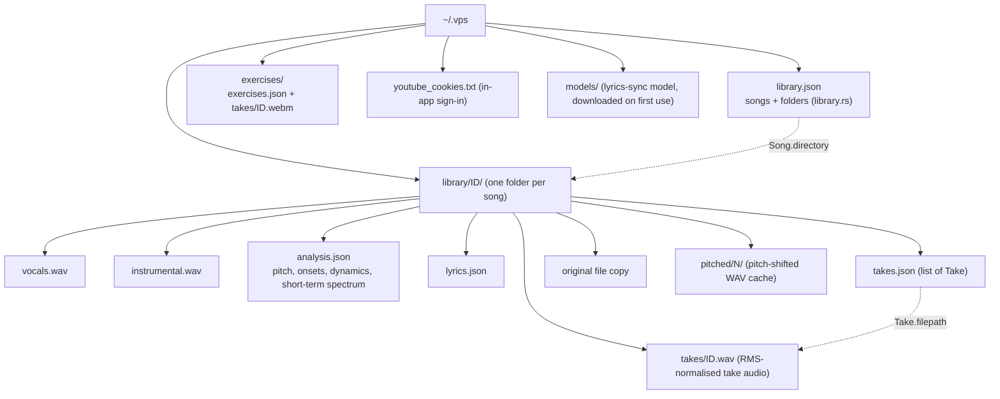

## 5. Player store (class view)

`usePlayerStore` is one Zustand store composed from nine slice creators (`src/stores/player/`). Slices are plain functions that share `get`/`set`; non-reactive objects (engine, recorder, timers) live in `singletons.ts`, not in state.

```mermaid
classDiagram
    direction TB
    class PlayerStore {
        <<usePlayerStore>>
    }
    class SongSlice {
        song, duration, transpose, isTransposing
        loadSong() cleanup() setTranspose()
    }
    class TransportSlice {
        isPlaying, currentTime, playbackRate
        loopStart, loopEnd, isLooping
        play() pause() seek() setPlaybackRate() toggleLoop()
    }
    class MixerSlice {
        vocalsVolume, instrumentalVolume, takeVolume
        mutedTracks, soloedTrack
        toggleMute() toggleSolo()
    }
    class TimelineSlice {
        minPxPerSec, scrollTime, metronomeOffset
        setZoom() setScrollTime()
    }
    class PunchSlice {
        punchIn, punchOut, punchLoop
        saveLoop() renameLoop() deleteLoop() applyLoopRegion()
    }
    class DevicesSlice {
        audioDevices, selectedDeviceId
        outputDevices, selectedOutputDeviceId
        recordingOffsets, usedLatencyFallback
        applyCalibration()
    }
    class TakesSlice {
        takes, shownTakeIds, activeTakeId
        takePlayback, mutedTakeIds, soloedTakeId, takeGains
        fetchTakes() deleteTake() renameTake() setTakeGain()
    }
    class RecordingSlice {
        isRecording, isSavingTake, isMonitoring
        countInBars, isCountingIn
        startRecording() stopRecording() startMonitoring()
    }
    class ExerciseSlice {
        exerciseMode
        startExercise() startExerciseRecording() stopExerciseRecording()
    }
    class Singletons {
        <<singletons.ts>>
        engine : AudioEngine
        recorder : VocalRecorder (core)
        session, mic analyser
    }
    class AudioSync {
        <<audioSync.ts>>
        installAudioSync()
        store subscriptions keep engine and analysis in step
    }
    class Persistence {
        <<persistence.ts>>
        localStorage: take prefs, recording offsets
    }

    PlayerStore *-- SongSlice
    PlayerStore *-- TransportSlice
    PlayerStore *-- MixerSlice
    PlayerStore *-- TimelineSlice
    PlayerStore *-- PunchSlice
    PlayerStore *-- DevicesSlice
    PlayerStore *-- TakesSlice
    PlayerStore *-- RecordingSlice
    PlayerStore *-- ExerciseSlice
    PlayerStore ..> Singletons : reads
    PlayerStore ..> AudioSync : installed once
    DevicesSlice ..> Persistence
    TakesSlice ..> Persistence
```

## 6. AudioEngine (class view)

VPS's shape is a **fixed** set of named tracks: `vocals` and `instrumental` WaveSurfers (the instrumental is master clock) plus a `Map` of take tracks (several loadable, one audible). This is the structural difference from SPS (`Map<string, WaveSurfer>` of stems), so engine features are re-derived, not copied.

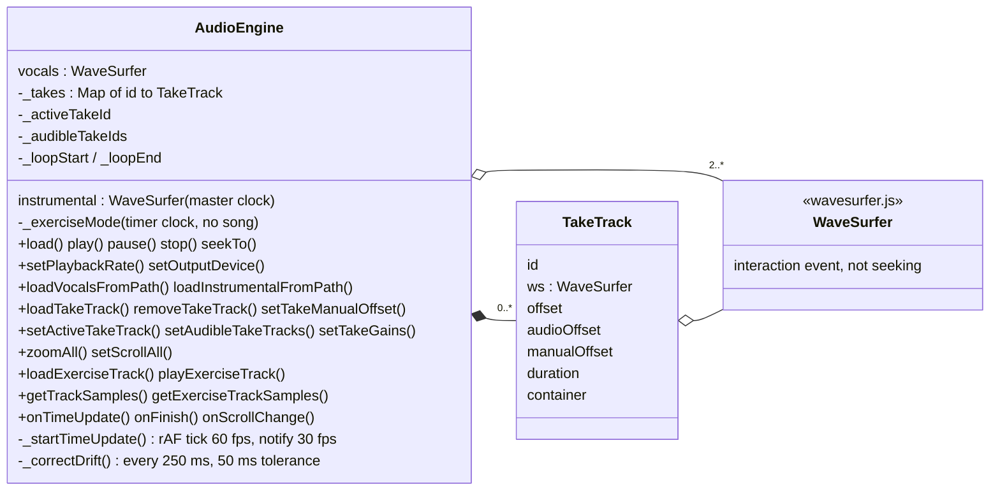

## 7. Live analysis chain (component view)

What the singer sees while singing comes from the browser; what is stored after the take comes from the sidecar. Both use the same stored `Song` pitch as the reference.

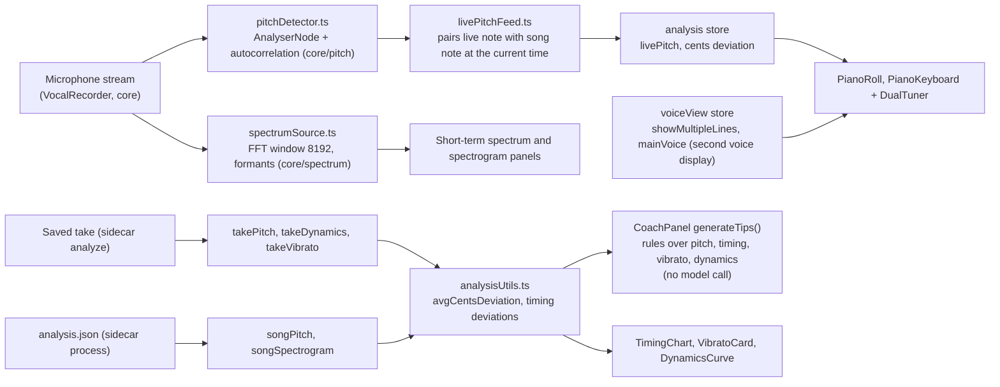

## 8. Rust backend (class view)

`commands.rs` is the orchestration point (46 commands are registered in all, the rest in `pack_share.rs`, `windows.rs`, `youtube_signin.rs`); `sidecar.rs` and `windows.rs` are thin wrappers over core crates. `pitch.rs` only decides *which* algorithm the sidecar runs (default `srh`, override `VPS_PITCH_ALGORITHM`).

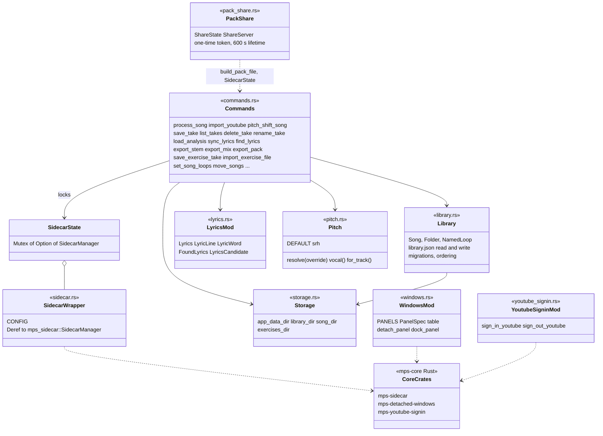

## 9. Python sidecar (component view)

`main.py` reads one JSON line at a time and dispatches on `cmd`. It is deliberately single-threaded. `pitch_lab/` is a research bench (A/B of algorithms), not shipped code.

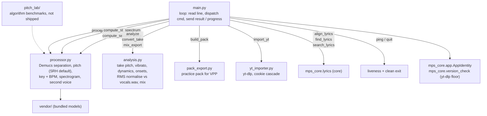

## 10. Process a song (sequence view)

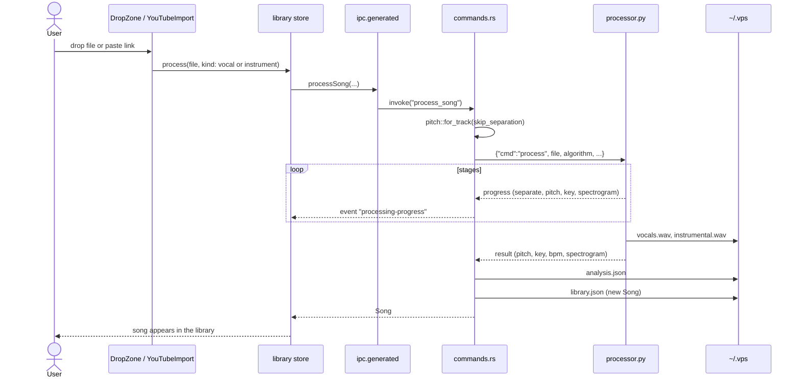

## 11. Record a take (sequence view)

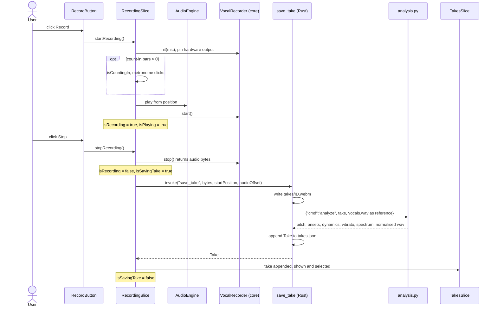

## 12. Recording states (state view)

The four booleans of the recording slice (`isMonitoring`, `isCountingIn`, `isRecording`, `isSavingTake`) behave as one machine; a take is never recorded while another is being saved.

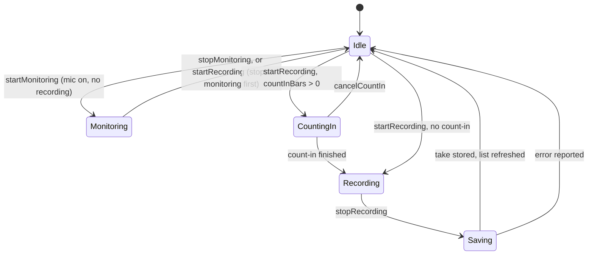

## 13. Send to phone (sequence view)

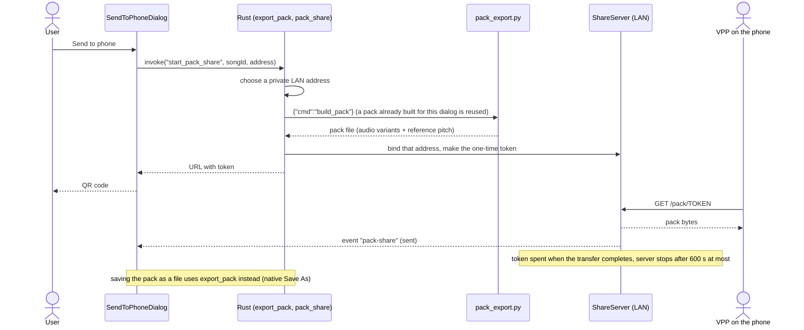

---

## Keeping this current

- Change the matching diagram in the same commit as a structural change (new slice, command, sidecar `cmd`, module, or on-disk file).
- Names in diagrams are searchable in the code. Drift risks: the slice list (5), the registered-command count (1, 8; `generate_handler!` in `lib.rs`), the sidecar command table (9), `PRACTICE_PANELS` ids (2).
- Every diagram was parsed with Mermaid 11.4.1 (`mermaid.parse`) on 2026-10-18; layout was not viewed. There is no CI check, so re-preview after editing.
